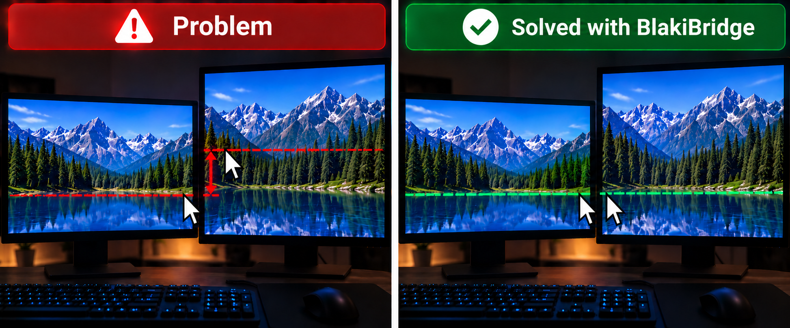
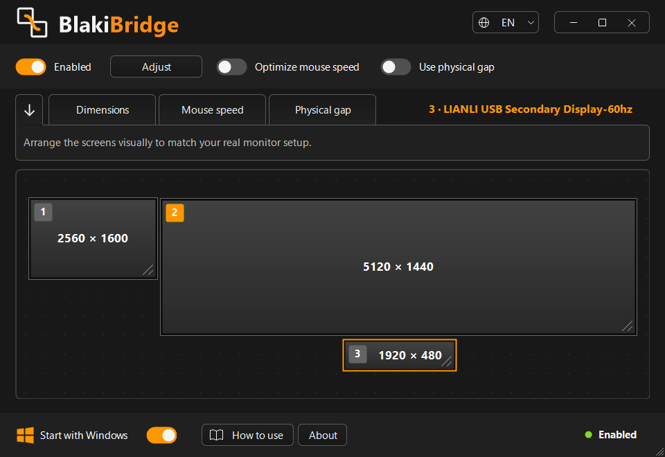
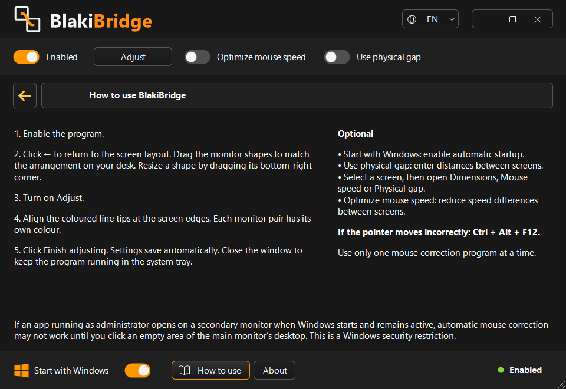
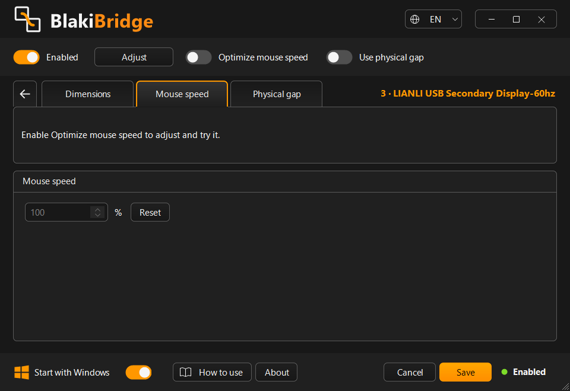
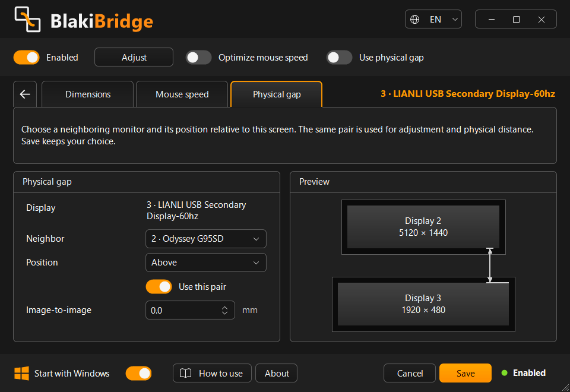
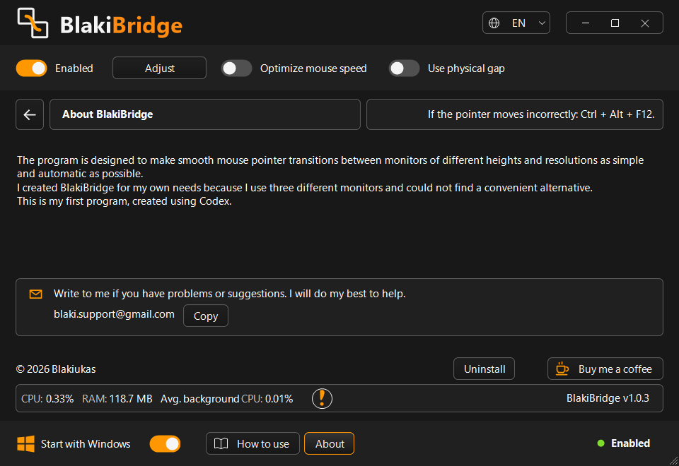

# BlakiBridge

[English](README.md) | [Lietuvių](README.lt.md) | [Русский](README.ru.md)

Smooth mouse pointer transitions between monitors of different sizes and resolutions.

**Free Windows app · Windows 10 (2004+) / Windows 11 · x64 · EN / LT / RU**

## Download

**[Download Setup (.exe)](https://github.com/Blakiukas/BlakiBridge/releases/download/v1.0.3/BlakiBridge-1.0.3-Setup.exe)** · **[Download Portable (.zip)](https://github.com/Blakiukas/BlakiBridge/releases/download/v1.0.3/BlakiBridge-1.0.3-Portable-x64.zip)** · **[Microsoft Store](https://apps.microsoft.com/detail/9NL5F77NL75W)**

[1.0.3 · Release notes](https://github.com/Blakiukas/BlakiBridge/releases) · [SHA256](https://github.com/Blakiukas/BlakiBridge/releases/download/v1.0.3/SHA256SUMS.txt)

BlakiBridge makes smooth mouse pointer transitions between monitors of different heights and resolutions as simple and automatic as possible. It takes monitor size, layout and physical gaps into account.

I created BlakiBridge for my own three-monitor setup because I could not find a convenient alternative. This is my first program, created using Codex.

### Choose your download

| Version | How to use it |
| --- | --- |
| Microsoft Store | Install through the Store. Store updates follow Microsoft's certification process. |
| Setup.exe | Install for your Windows account. Choose the installation folder and shortcuts; optionally enable Windows startup. |
| Portable ZIP | Extract the entire ZIP to a writable folder and run `BlakiBridge.exe`. No installation needed. Windows startup is unavailable in portable mode. |

The standalone downloads include the required runtime. The Setup executable is not signed with a trusted publisher certificate, so Windows may display an unknown-publisher or SmartScreen warning. The Microsoft Store package is distributed through Microsoft's signing process.

### Quick start

1. Enable the program.
2. Arrange the monitor shapes to match your desk. Drag a shape to move it; drag its bottom-right corner to resize it.
3. Turn on **Adjust** and align the coloured line tips at the screen edges. Each monitor pair has its own colour.
4. Click **Finish adjusting**. Settings save automatically. Closing the window keeps the program running in the system tray.

Select a screen to open **Dimensions**, **Mouse speed** or **Physical gap**. Mouse speed optimisation and physical-gap correction are optional.

**If the pointer moves incorrectly: Ctrl + Alt + F12.** Use only one mouse correction program at a time. Exit other BlakiBridge copies through their tray menu before starting another version.

Portable settings and diagnostics are stored in the adjacent `Data` folder. Keep `Data` when updating and leave `portable.flag` next to the executable. To remove the portable version and its data, exit it and delete its extracted folder.

If an app running as administrator opens on a secondary monitor at Windows startup and remains active, correction may not work until you click an empty area of the main monitor's desktop. This is a Windows security restriction.

## Screenshots

Screenshots (5)

## Support

[blaki.support@gmail.com](mailto:blaki.support@gmail.com)

Free to use. Program source code is not included.

© 2026 Blakiukas

[License](LICENSE.txt) · [Privacy](PRIVACY.md) · [Third-party notices](THIRD-PARTY-NOTICES.txt)
